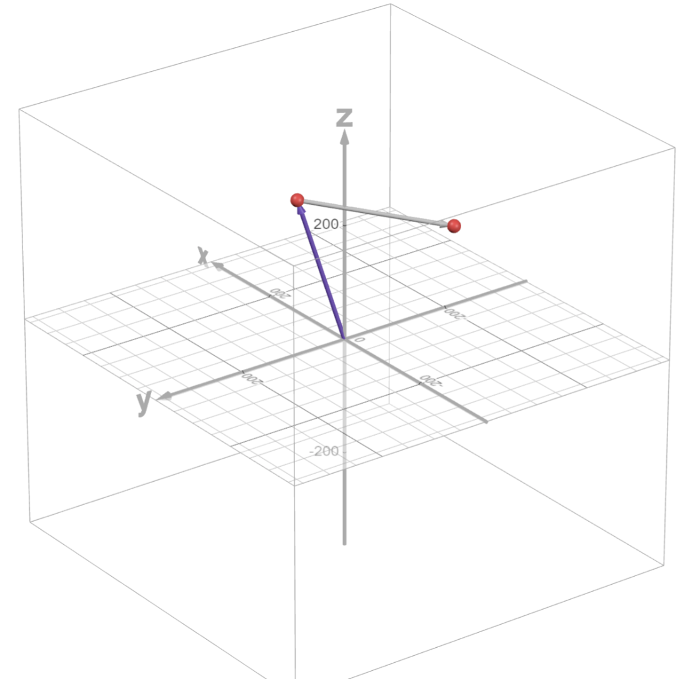

# Lesson 3: Trigonometric Approach to Forward Kinematics

Students learn forward kinematics: calculating where the end effector ends up from a set of joint angles. On Day 1 they use SOH-CAH-TOA to derive the equations for a simplified 2-link arm in 2D. On Day 2 they add the base rotation to find the position in 3D, and check their answers against the physical arm and an interactive 3D model.

**Time:** two class periods (about 60 minutes each)

## Objectives

By the end of this lesson, students will be able to:

- Explain forward kinematics as calculating end-effector position from known joint angles
- Apply trigonometry (SOH-CAH-TOA) to a series of rotating joints
- Derive the forward kinematics equations for a simplified 2-link planar arm
- Calculate the end-effector position for a given set of joint angles

## Files

| File | What it is |
|------|------------|
| [Lesson Plan 3 - Trigonometric Approach to FK.pdf](Lesson%20Plan%203%20-%20Trigonometric%20Approach%20to%20FK.pdf) | Lesson plan with timed procedures, worked answers and assessment |
| [Lesson Plan 3 - Trigonometric Approach to FK.docx](Lesson%20Plan%203%20-%20Trigonometric%20Approach%20to%20FK.docx) | Lesson plan (Word, editable) |
| [Trigonometry FK.pdf](Trigonometry%20FK.pdf) | Slides (PDF) |
| [Trigonometry FK.pptx](Trigonometry%20FK.pptx) | Slides (PowerPoint, editable) |

## Interactive 3D model

Explore the arm's forward kinematics using the trigonometric approach in Desmos:
[Open the Desmos graph](https://www.desmos.com/3d/9bnvqc263x)

**Previous:** [Lesson 2](../Lesson%202/) · **Next:** [Lesson 4: Denavit-Hartenberg Approach to FK](../Lesson%204/)
