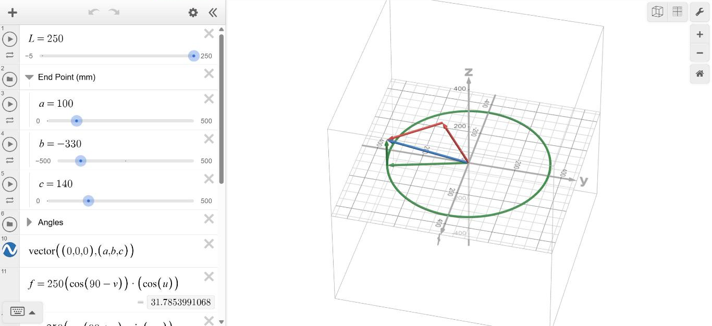

# Lesson 6: Trigonometric Approach to Inverse Kinematics

Students meet inverse kinematics (IK), the reverse of the forward kinematics from Lessons 3–5: instead of turning joint angles into a tip position, they start from a target and find the joint angles. On Day 1 they solve the flat arm with triangles. The two links and the line D from the shoulder to the target make a triangle, so the law of cosines gives the elbow angle θE and the shoulder angle θS. On Day 2 they add the base turn: atan2 aims the base, the target is flattened into the arm's upright plane, and Day 1's steps finish the job. Every answer is checked with forward kinematics, using the link table, the Lesson 4 Desmos graph or the code from Lesson 5.

**Time:** two class periods (about 60 minutes each)

## Objectives

By the end of this lesson, students will be able to:

- Explain the difference between forward and inverse kinematics
- Use the law of cosines to find an angle of a triangle when all three sides are known
- Explain why the two links and the line D to the target make a triangle, and use it to find θE and θS for the flat arm
- Find the base angle θB with atan2, and flatten a 3D target into the arm's plane with R = √(x² + y²)
- Decide whether a target is reachable, and explain why a target can have two answers (elbow up and elbow down)
- Check an IK answer with forward kinematics, and describe the strengths and limits of the trigonometric method

## Files

| File | What it is |
|------|------------|
| [Lesson Plan 6 - Trigonometric Approach to IK.pdf](Lesson%20Plan%206%20-%20Trigonometric%20Approach%20to%20IK.pdf) | Lesson plan with timed procedures, worked answers and assessment |
| [Lesson Plan 6 - Trigonometric Approach to IK.docx](Lesson%20Plan%206%20-%20Trigonometric%20Approach%20to%20IK.docx) | Lesson plan (Word, editable) |
| [Lesson_6_Trigonometric_Approach_to_IK.pdf](Lesson_6_Trigonometric_Approach_to_IK.pdf) | Slides (PDF) |
| [Lesson_6_Trigonometric_Approach_to_IK.pptx](Lesson_6_Trigonometric_Approach_to_IK.pptx) | Slides (PowerPoint, editable) |

## The recipe

All angles use the DH convention from Lessons 4 and 5, with L1 = L2 = 250 mm.

1. Aim the base: θB = atan2(y, x)
2. Flatten: R = √(x² + y²), then D² = R² + z²
3. Elbow: cos θE = (D² − L1² − L2²) ÷ (2 L1 L2). Elbow up, so θE is negative. If cos θE is not between −1 and 1, the target is out of reach.
4. Shoulder: θS = φ + δ, with φ = tan⁻¹(z ÷ R) and cos δ = (L1² + D² − L2²) ÷ (2 L1 D)

The worked example finds θB = 45°, θS = 45°, θE = −45° for the target (301.78, 301.78, 176.78), the tip from Lesson 4.

## Interactive 3D model

Explore inverse kinematics with trigonometry in Desmos:
[Open the Desmos graph](https://www.desmos.com/3d/htnj6o4pbv)

Set the target in the End Point folder (a, b, c are x, y, z in mm). The Angles folder shows the answer and the graph draws the arm reaching the target:

- u is the base angle θB
- v is the shoulder angle measured from straight up, like θ1 in Lesson 3, so θS = 90° − v
- w is the elbow angle θE

For the worked example (301.78, 301.78, 176.78), the graph shows u = 45, v = 45 and w = −45. For Try It Yourself #4 (295.75, 170.75, 91.51) it shows u = 30, v = 30 and w = −90, so θS = 90° − 30° = 60°.

To check an answer with forward kinematics, use the [Lesson 4 Desmos graph](https://www.desmos.com/3d/qq1w1zrs78) with u = θB, v = θS and w = θE.

**Previous:** [Lesson 5](../Lesson%205/) · **Next:** [Lesson 7: Gradient Descent Approach to IK](../Lesson%207/)
