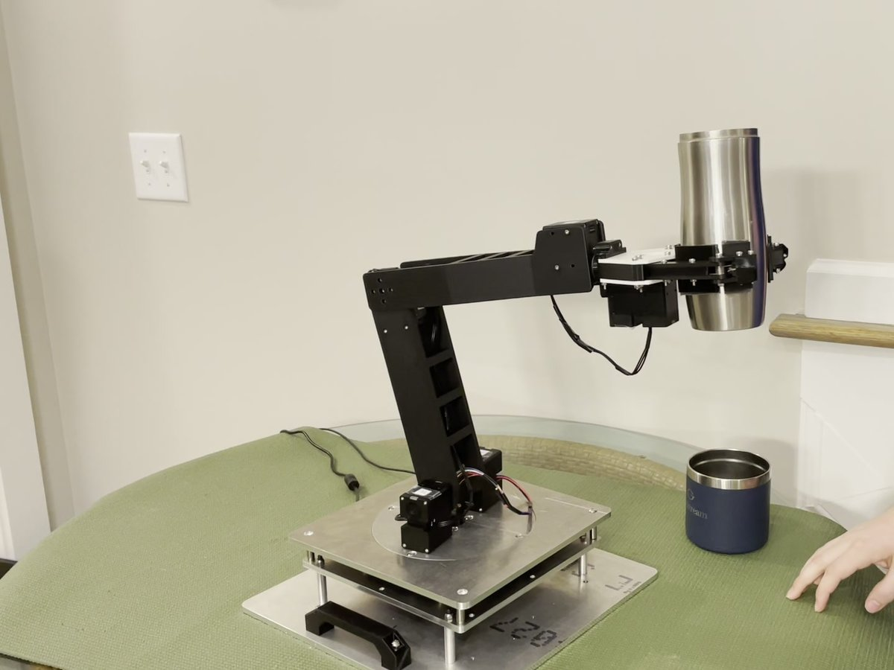
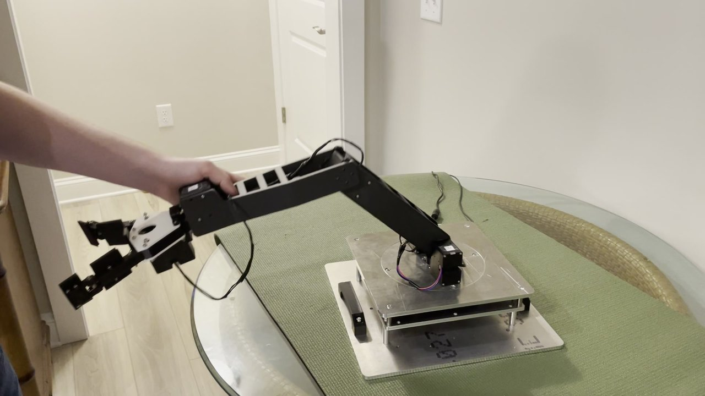
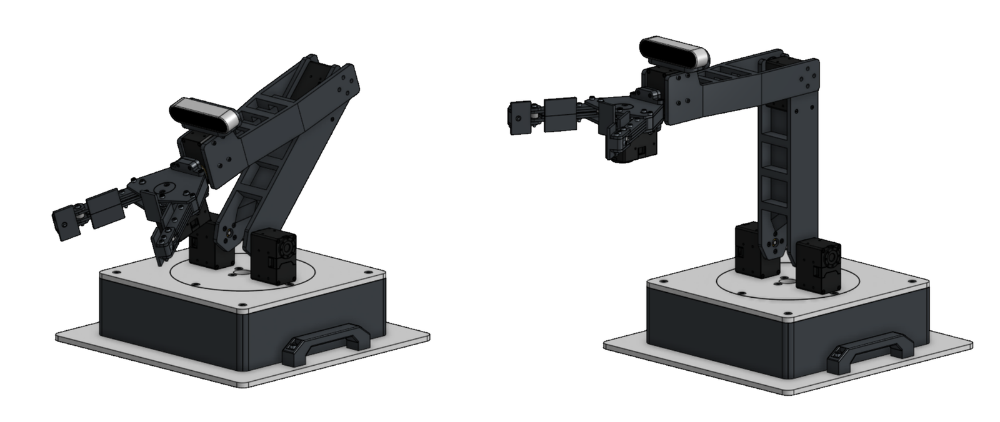
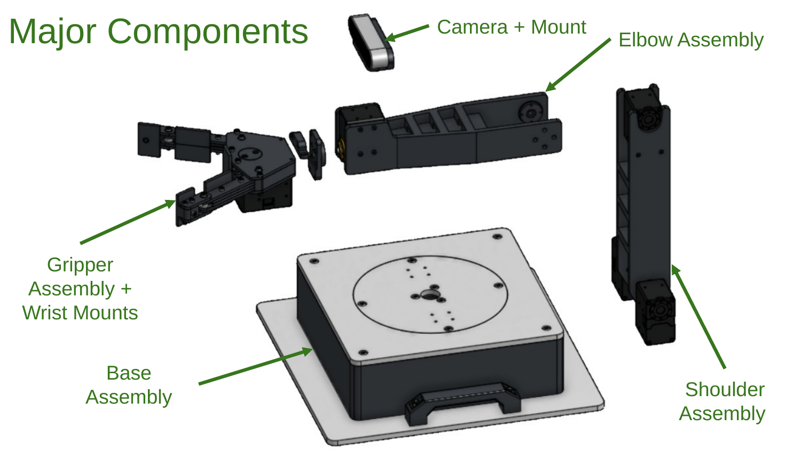
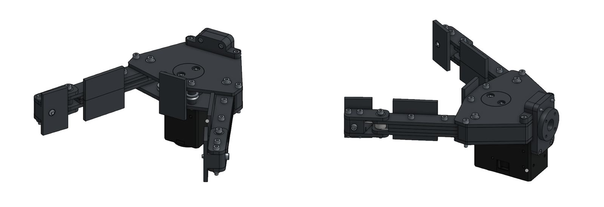
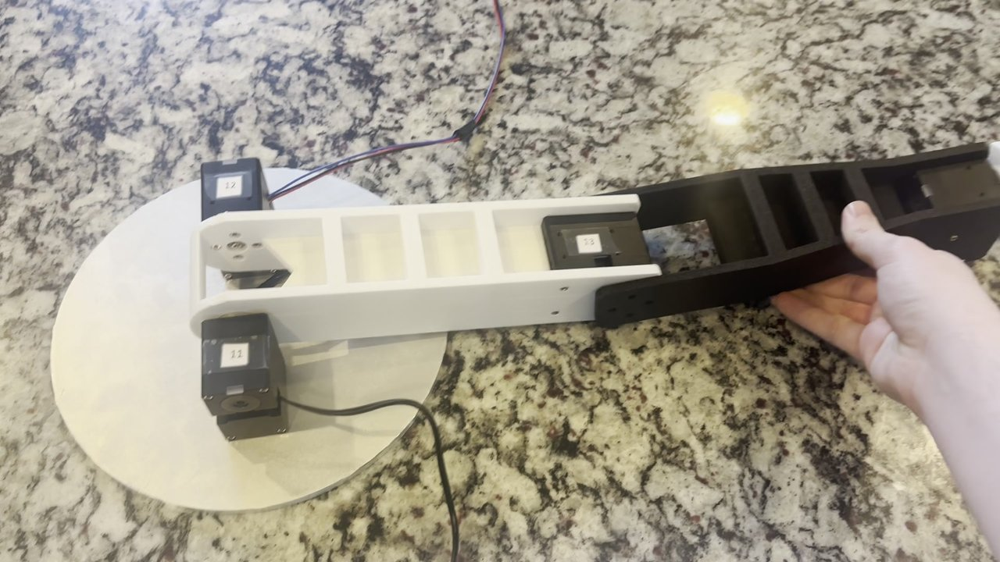
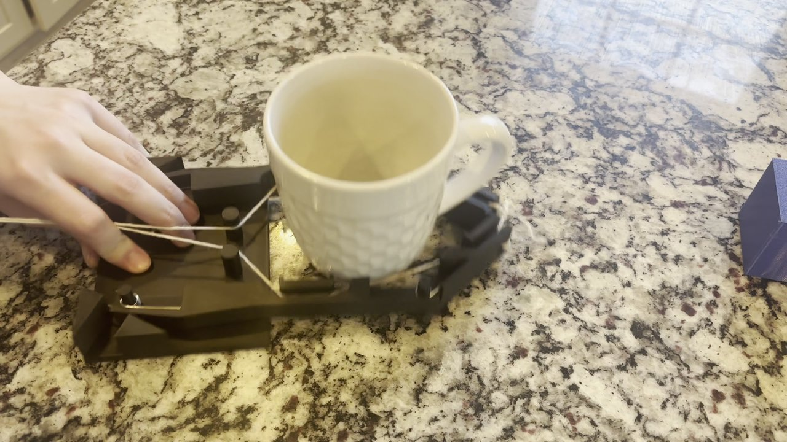
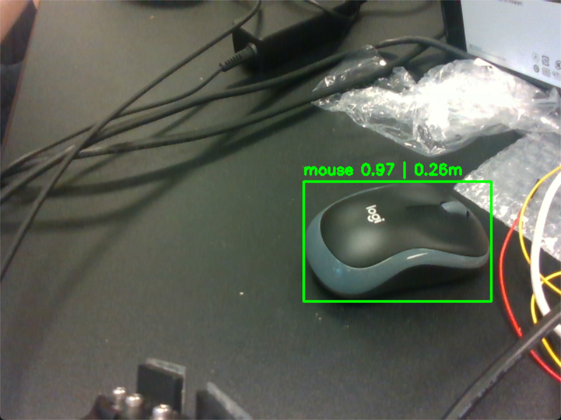

# Photos

## The built arm

| | |
|:---:|:---:|
|  |  |
| Holding a tumbler | Reaching out, moved by hand |

## CAD model

*The complete arm, folded (left) and upright (right).*

*The arm's main assemblies: base, shoulder, elbow, gripper and wrist mounts, and camera mount. The [assembly instructions](../Assembly%20Instructions/All%20Assembly%20Instructions.pdf) build each one step by step.*

*The underactuated two-finger gripper.*

## Prototypes

| | |
|:---:|:---:|
|  |  |
| Early arm prototype | Gripper prototype grasping a mug |

## Vision

*YOLOv8 detecting a mouse through the RealSense D435i, with its distance from the camera. This is the output of [`vision_object_detection_test.py`](../Code/vision_object_detection_test.py).*
