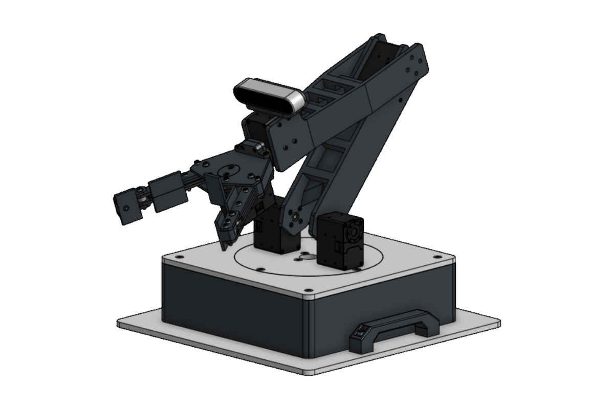
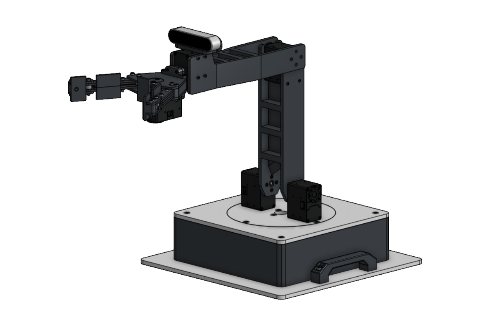
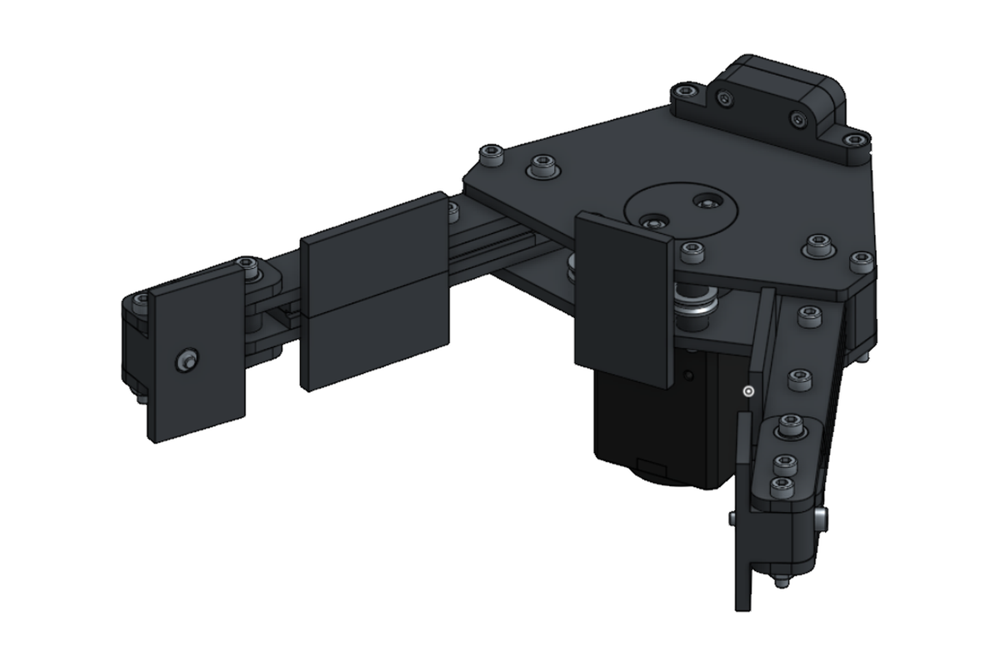
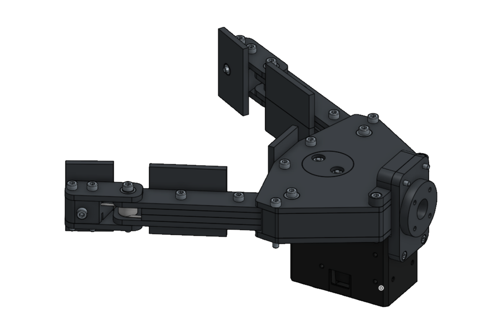
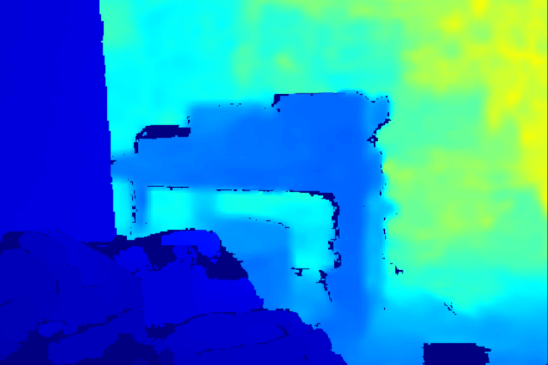

# Photos

Pictures of the PETFAB Armadillo: the built arm, its CAD model, early prototypes, and what its camera sees.

## The built arm

  
  

<em>Holding a tumbler (left) and reaching out, moved by hand (right)</em>

## CAD model

  
  

<em>The complete arm, folded (left) and upright (right)</em>

  

<em>The main assemblies. The <a href="../Assembly%20Instructions/All%20Assembly%20Instructions.pdf">assembly instructions</a> build each one step by step.</em>

  
  

<em>The underactuated two-finger gripper, from two angles</em>

## Prototypes

  
  

<em>An early arm prototype (left) and the gripper prototype grasping a mug (right)</em>

## Vision

  
  

<em>YOLOv8 detecting a mouse 0.26 m away (left), from <a href="../Code/vision_object_detection_test.py"><code>vision_object_detection_test.py</code></a>, and a depth image from the same camera, where color shows distance (right)</em>

