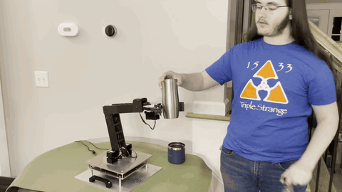
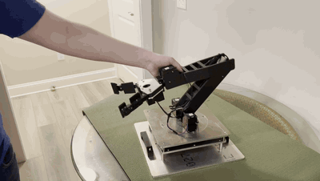
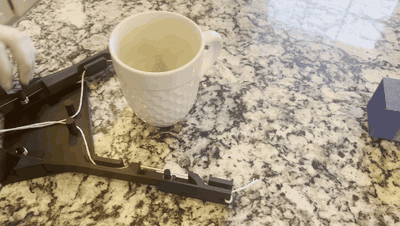

# PETFAB Armadillo – 4-DOF Educational Robotic Arm

**An open, buildable robotic arm and full curriculum that takes students from turning a screwdriver to writing code that tells a robot where it is, where to go, and what it sees.**

<p align="center">
  
</p>

---

## About the Project

The **PETFAB Armadillo** is a 4-degree-of-freedom robotic arm developed at the **CABS Lab (Smart Connected Autonomous Bots), NC A&T State University**, as part of the PETFAB program. It was built to give high school students hands-on experience with the same ideas behind industrial, medical, and service robots: actuators, encoders, kinematics, and AI-based perception.

Most educational arms are either toys that hide the engineering or industrial machines too costly and complex for a classroom. The Armadillo sits in between. Students assemble it themselves from 3D-printed parts, a few machined aluminum plates, and off-the-shelf hardware. It uses the same type of smart servo actuators found in research robots, and it carries a depth camera so it can perceive the world around it.

### What students do with it

1. **Build it.** Assemble the arm, wire the actuators, and run first power-on tests.
2. **Understand where it is.** Derive and code *forward kinematics* to calculate where the gripper is from the joint angles.
3. **Tell it where to go.** Derive and code *inverse kinematics* to work out the joint angles needed to reach a target.
4. **Let it see.** Use stereo depth sensing and AI object detection to perceive the objects around it.

### Who it's for

- **High school teachers** running engineering, robotics, or advanced STEM courses (aligned with NGSS HS-ETS1 engineering design standards)
- **Students** with Geometry/Math 3 and intermediate Python who want a real robotics project
- **Makerspaces, outreach programs, and university labs** looking for an affordable, open platform for teaching manipulation and computer vision

### Highlights

- 🦾 4 DOF (base, shoulder, elbow, wrist) plus a spring-loaded, underactuated two-finger gripper
- ⚙️ Robotis Dynamixel XM540-W270-T smart actuators with built-in encoders
- 👁️ Intel RealSense D435i depth camera with YOLOv8 object detection
- 🖥️ Point-and-click GUI to teach, save, and replay waypoint sequences
- 📚 10-lesson curriculum with lesson plans, slides, worked problems, and assessments (Lessons 1–7 available now)
- 🔓 Open assembly instructions, bill of materials, curriculum, and code, with design files on the way

## See It in Action

<!-- VIDEO PLAYER: drag arm-demo.mp4 onto the blank line below, then delete everything from "preview start" to "preview end". -->

<!-- preview start -->
<p align="center">
  <a href="Videos/arm-demo.mp4"></a>
</p>
<!-- preview end -->
<p align="center"><em>Joseph Ruhan demonstrates the finished arm moving on its own, gripping objects handed to it, and being guided by hand. <a href="Videos/arm-demo.mp4">Watch the full video with narration (49 s)</a>.</em></p>

<p align="center">
  <a href="Videos/range-of-motion.mp4"></a>
  <a href="Videos/gripper-prototype.mp4"></a>
</p>
<p align="center"><em>The range of motion (left, <a href="Videos/range-of-motion.mp4">26 s</a>) and the underactuated gripper prototype (right, <a href="Videos/gripper-prototype.mp4">15 s</a>)</em></p>

More clips are in [Videos](Videos/).

## Gallery

<p align="center">
  
  
</p>
<p align="center"><em>The built arm holding a tumbler (left) and reaching out (right)</em></p>

<p align="center">
  
  
</p>
<p align="center"><em>The underactuated gripper prototype (left) and YOLOv8 object detection through the depth camera (right)</em></p>

More pictures, including CAD renders and an exploded view, are in [Photos](Photos/).

---

## Contents

| Folder | What's inside |
|--------|---------------|
| [Assembly Instructions](Assembly%20Instructions/) | Step-by-step build guide for the base, shoulder, elbow, gripper, and full arm (PowerPoint + PDF) |
| [BOM](BOM/) | Bill of materials with quantities, materials, and purchase links (Excel + PDF) |
| [Curriculum](Curriculum/) | Course overview plus lesson plans and slides for Lessons 1–7 |
| [Code](Code/) | Waypoint teach/replay GUI, camera and object-detection test, and the Lesson 5 forward kinematics scripts |
| [3D Printing Files](3D%20Printing%20Files/) | Printable links, plates, and gripper parts *(coming soon)* |
| [CAD](CAD/) | Design source files *(coming soon)* |
| [User Manuals](User%20Manuals/) | Actuator and camera datasheets *(coming soon)* |
| [Photos](Photos/) | Photos of the built arm and prototypes, CAD renders, and camera screenshots |
| [Videos](Videos/) | Demo, range-of-motion, and prototype videos |

## Specs

- 4 degrees of freedom: base, shoulder, elbow, wrist
- Underactuated two-finger, spring-loaded gripper driven by a cable coiler
- Robotis Dynamixel XM540-W270-T actuators (with motor, gearbox, and encoder) at every joint and the gripper
- Base driven through a 12T to 36T gear (3:1 reduction) on a bearing-supported turntable
- 3D-printed links and gripper parts (PETG and PLA) and CNC-machined 6061 aluminum base plates, assembled with M2.5 / M3 / M5 hardware
- Intel RealSense D435i depth camera mounted on the arm for object detection
- Controlled from a PC over Dynamixel Protocol 2.0 at 1 Mbps

## Getting Started

1. Buy the parts listed in the [Bill of Materials](BOM/Arm%20BOM.xlsx).
2. Print the 3D-printed parts and machine the aluminum plates *(files coming soon in [3D Printing Files](3D%20Printing%20Files/) and [CAD](CAD/))*.
3. Build the arm following the [assembly instructions](Assembly%20Instructions/All%20Assembly%20Instructions.pdf).
4. Set up the actuators. In ROBOTIS Dynamixel Wizard 2.0, set every actuator to Protocol 2.0 at 1 Mbps and give each one the ID the code expects:

   | Joint | ID |
   |-------|----|
   | Base | 10 |
   | Shoulder | 11 |
   | Elbow | 13 |
   | Wrist | 14 |
   | Gripper | 15 |

   If you use different IDs, change them near the top of `Code/waypoint.py` instead.
5. Install Python 3, then install the requirements from the repository's main folder:
   ```
   pip install -r requirements.txt
   ```
6. In `Code/waypoint.py`, set `DEVICENAME` to your serial port (for example `COM5` on Windows).
7. Run the waypoint GUI:
   ```
   python Code/waypoint.py
   ```
   To load and replay a saved sequence automatically: `python Code/waypoint.py sequence.json`
8. To test the camera and object detection: `python Code/vision_object_detection_test.py`. Press `q` to quit.

## Code

| File | What it does |
|------|--------------|
| [`waypoint.py`](Code/waypoint.py) | Tkinter GUI for jogging the arm with inverse kinematics, teaching waypoints by hand (torque off), opening and closing the gripper, and saving and replaying waypoint sequences as JSON. Runs without hardware for previewing. |
| [`vision_object_detection_test.py`](Code/vision_object_detection_test.py) | Streams color and depth from the RealSense D435i, runs YOLOv8n object detection, and prints each detected object's 3D position in meters. |

**Lesson 5 forward kinematics scripts.** These need only Python 3 (plus matplotlib for the optional reach plot) and assume link lengths of 250 mm. See the [Lesson 5 README](Curriculum/Lesson%205/) for the order to use them in.

| File | What it does |
|------|--------------|
| [`arm_starter.py`](Code/arm_starter.py) | Student starter: save as `arm.py` and add the forward kinematics functions one step at a time |
| [`arm.py`](Code/arm.py) | Teacher solution: forward kinematics with vectors and the DH angles (`flat_tip` for the flat arm, `tip_3d` for the 3D arm), plus Lesson 3's method as `trig_tip` |
| [`reach_sweep.py`](Code/reach_sweep.py) | Tries 100 shoulder and elbow angles and prints the farthest and nearest tip distances |
| [`reach_plot.py`](Code/reach_plot.py) | Plots where the arm's tip can reach (needs matplotlib) |

## Educational Use

The curriculum takes students from building the arm through forward kinematics, inverse kinematics, and stereo vision with AI object detection. It is aligned with NGSS engineering design standards (HS-ETS1-1 to HS-ETS1-4). See the [Curriculum folder](Curriculum/) for the course overview.

| # | Lesson | Status |
|---|--------|--------|
| 1 | [Introduction to the Robotic Arm](Curriculum/Lesson%201/) | Included |
| 2 | [Building the Robotic Arm](Curriculum/Lesson%202/) | Included |
| 3 | [Trigonometric Approach to FK](Curriculum/Lesson%203/) | Included |
| 4 | [Denavit-Hartenberg Approach to FK](Curriculum/Lesson%204/) | Included |
| 5 | [Code Implementation of FK](Curriculum/Lesson%205/) | Included |
| 6 | [Trigonometric Approach to IK](Curriculum/Lesson%206/) | Included |
| 7 | [Gradient Descent Approach to IK](Curriculum/Lesson%207/) | Included |
| 8 | Code Implementation of IK | Planned |
| 9 | Stereoscopic Camera | Planned |
| 10 | AI Object Detection | Planned |

Prerequisites: high school Math 3 / Geometry and intermediate Python.

## Safety

- Keep fingers out of the gap between the upper and lower arm segments (pinch point).
- Stay clear of the arm while it is powered.
- If the arm moves unexpectedly, cut power immediately.

## Credits

- Original design, assembly instructions, curriculum, and software by Joseph Ruhan
- CABS Lab, NC A&T State University

## Third-Party Software

- Dynamixel SDK (Apache-2.0) – https://github.com/ROBOTIS-GIT/DynamixelSDK
- Intel RealSense SDK / pyrealsense2 (Apache-2.0) – https://github.com/IntelRealSense/librealsense
- Ultralytics YOLOv8 (AGPL-3.0) – https://github.com/ultralytics/ultralytics
